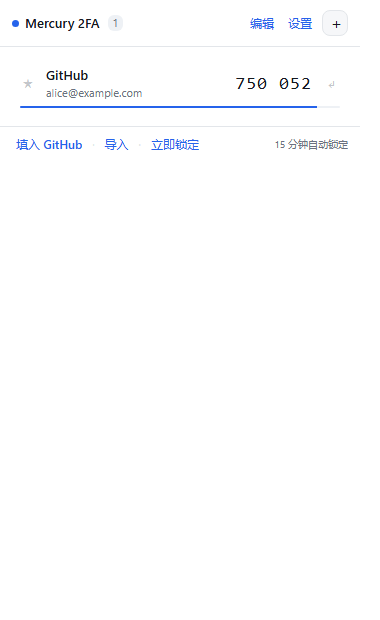

# Mercury 2FA

离线的 2FA 验证码扩展，支持 Chrome 与 Edge。不联网、不注册账号、不上云。

当前版本 **v0.5.0**：加密保险库 + 一键填入当前页。安装时不申请任何站点权限。

| 列表与填入入口 |
|---|
|  |

## 已实现

| 模块 | 内容 |
|---|---|
| 取码内核 | TOTP / HOTP / Steam，走 WebCrypto，无自研密码学 |
| 加密 | Argon2id（hash-wasm）派生 KEK → 包住随机 DEK → AES-GCM-256 加密条目 |
| 解锁 | 主密码解锁，空闲 5/15/30/60 分钟自动锁定，系统空闲或锁屏立刻丢弃 DEK |
| 迁移 | 首次创建时自动把 v0.1 的明文库加密并入，原键删除 |
| 条目 | 添加 / 删除 / 置顶 / STEAM 与 HOTP 变体 / 倒计时进度条 / 剩余 5 秒转红 |
| 导入 | Google Authenticator 迁移码、Aegis、2FAS、andOTP、Bitwarden、otpauth 链接串 |
| 备份 | 加密备份导出与恢复、更换主密码（只重封装 DEK，库体不重写）、恢复时核对条数 |
| 自动填充 | 点图标后用 `activeTab` 临时注入，识别验证码框并写入；支持六格拆分与 shadow DOM |
| 自检 | 内置四项检查：往返解密、错误密码拒绝、密文篡改检测、派生耗时 |

## 自动填充的边界

用 `activeTab` + `scripting.executeScript`，只有用户点开扩展图标的那一刻，浏览器才把当前标签页的注入权临时交出来。manifest 里没有 `host_permissions`，也没有常驻 `content_scripts`。

代价是两次点击：点图标、点「填入」。换来的是安装时权限面板只有「读取当前标签页」，商店审核不看站点清单。

识别打分（累加，≥ 60 分才写入）：

| 信号 | 分值 |
|---|---|
| `autocomplete="one-time-code"` | 100 |
| `autocomplete` 含 otp / code | 60~90 |
| `inputmode` 为 numeric/tel 且 `maxlength` 在 4~8 | 60 |
| name / id / placeholder / aria-label 含 otp、code、token、验证码 | 50 |
| 同表单内有密码字段 | +20 |
| `pattern` 是数字类 | +20 |
| `maxlength` 等于期望位数 | +20 |
| `type=password` / 隐藏 / 不可见 | 直接排除 |

四层兼容，缺一层就会在某些站点失效：

- **React / Vue 受控输入**：`HTMLInputElement.prototype` 的原生 setter 赋值，再派发 `input` 与 `change`
- **shadow DOM**：递归遍历 `shadowRoot`，`document.querySelector` 看不见的部分也能找到
- **六格拆分框**：同容器内 4~8 个 `maxlength=1` 且没有混入其他字段时，逐格写入并补 `keydown`/`keyup`
- **祖先链隐藏**：一路检查父级 `display:none` / `visibility:hidden`，只查自身会填到看不见的框

填充函数是自包含的：它被序列化后送进页面，拿不到种子、DEK 或保险库，只收到一个已经算好的验证码。

## 验证结果

| 项目 | 结果 |
|---|---|
| 单元测试 | 105 项全通过 |
| RFC 4226 十组 HOTP 向量 | 全部匹配 |
| RFC 6238 六时点 × SHA1/256/512 | 18 组全部匹配 |
| 加密属性测试 | 错误密码拒绝、单字节篡改拒绝、IV 不重复、密文里搜不到明文 |
| 备份格式分级 | 损坏 / 非本扩展 / 版本过新 / 内容不全 / 密码错，五类可区分 |
| 填充识别 | 13 项：命中、拒绝、六格、shadow DOM、React 拦截绕过、隐藏元素排除 |
| 端到端填充 | 无头 Chrome 里点「填入 GitHub」，`executeScript` 真实执行，输入框得到与列表一致的码 |
| 类型检查 | `tsc --noEmit` 0 错误 |
| 产物 | 334 KB，权限 `storage`、`idle`、`clipboardWrite`、`activeTab`、`scripting`，无 `host_permissions` |

## 未实现（明确列出）

| 项 | 卡在哪 |
|---|---|
| 常驻挂标（零点击） | 需要可选站点权限 + 商店逐条写理由，等 activeTab 路径跑够数据再说 |
| 截图二维码导入 | 需要 `captureVisibleTab` + zxing-wasm，另加约 1.5MB |
| 剪贴板定时回清 | service worker 没有 DOM，需要 offscreen document |
| 图标、i18n、双商店上架 | 收尾工程，功能稳定后再做 |

## 安全模型

防住：

- 磁盘上的库：`chrome.storage.local` 里只有密文，攻击者拿到浏览器配置目录也解不开
- 浏览器退出后的密钥：DEK 存在 `chrome.storage.session`（内存态），关浏览器即失
- 挂着不用的会话：空闲超时、系统空闲、锁屏三处都会丢弃 DEK
- 密码猜错与密文被改：AES-GCM 认证失败直接拒绝，不做任何降级；解包失败报密码错，解包成功但解不开报内容损坏，两者提示分开
- 主密码更换：只重封装 DEK，旧密码立即失效
- 网页读种子：填充只传一个算好的验证码，页面侧拿不到种子

不防：

- 解锁期间本机进程读扩展内存
- 键盘记录器与剪贴板嗅探
- 主密码忘记（没有后门，也没有找回流程，只有备份文件）
- 恢复码丢失

## 架构

```
entrypoints/popup      React 界面：锁屏、列表、添加、导入、设置
entrypoints/background service worker：系统空闲/锁屏时丢弃 DEK
lib/fill/autofill.ts   注入到页面的自包含填充函数（识别打分 + 三种写入方式）
lib/fill/inject.ts     activeTab 注入通道与结果翻译
lib/fill/site-match.ts 站点与发行方匹配（注册域、分词、编辑距离）
lib/vault-service.ts   业务逻辑（可注入时钟与存储，全部单测覆盖）
lib/crypto.ts          Argon2id + AES-GCM + 备份格式
lib/crypto-host.ts     加密边界；换 offscreen 实现时上层不动
lib/browser-store.ts   storage.local / storage.session 适配
lib/importers.ts       GA protobuf、各家 JSON、otpauth 串
lib/totp.ts …          取码内核
tests/                 105 项
```

**一处与最初设计的偏离**：DEK 现在放在 `chrome.storage.session`，没进 offscreen document。两者都是内存态、关浏览器即失、其他扩展与网页都读不到；session 存储省掉消息中转与生命周期管理。`CryptoHost` 接口留着，等剪贴板回清需要 offscreen 时换实现，上层不用动。

## 数据格式

```ts
{
  schemaVersion: 2,
  kdf: { name: 'argon2id', m: 65536, t: 3, p: 1, salt: '<16B base64>' },
  wrappedDek: { iv: '<12B>', data: '<AES-GCM 密文>' },
  payload:    { iv: '<12B>', data: '<条目 JSON 的密文>' },
  entryCount: 3,
  createdAt, updatedAt
}
```

备份文件是 `{ format: 'mercury-2fa-backup', version: 2, exportedAt, entryCount, vault }`，`entryCount` 明文存放，恢复时与实际解出的条数比对。格式只服务本项目，不与其它项目共用。

三档派生强度：低 19MiB/t=2（约 100ms）、中 64MiB/t=3（约 400ms）、高 256MiB/t=4（约 1.5s）。参数写在密文头里，换档只重封装密钥。

## 命令

```bash
npm install
npm test              # 105 项，含 RFC 向量与 jsdom 填充测试
npm run compile       # tsc --noEmit
npm run build         # .output/chrome-mv3
npm run build:edge    # .output/edge-mv3
```

## 加载与绑定 GitHub

1. `chrome://extensions` → 开发者模式 → 加载已解压 → `.output\chrome-mv3`
2. 首次打开设主密码（建议中档），记录到密码管理器
3. GitHub → Settings → Password and authentication → Enable 2FA → Authenticator app → **enter this text code**
4. 扩展点 ＋，发行方 `GitHub`，账号填用户名，种子粘那串 32 位 setup key（空格会自动清掉）
5. 在 GitHub 的验证页点扩展图标，底部出现「填入 GitHub」，点一下自动写入
6. **立即到设置里导出加密备份**，并把 GitHub 的 recovery codes 存好

## 下一步

1. 在真实登录页回归：GitHub、Google、AWS、Cloudflare，外加十个只有密码框的页面验证零误填
2. 可选开启常驻内容脚本，换取页面加载即挂标的零点击体验
3. 截图二维码导入（`captureVisibleTab` + zxing-wasm）
4. offscreen 加密仓与剪贴板回清
5. 双商店上架与 `_locales`
