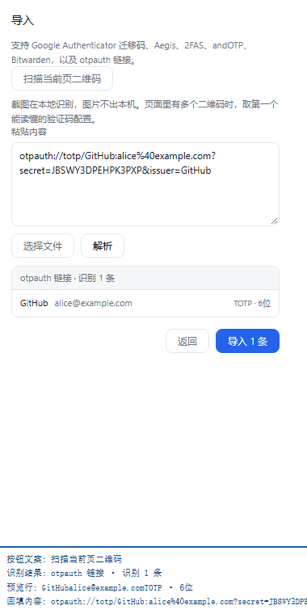

# Mercury 2FA

**English** | [简体中文](README.zh-CN.md)

Two-factor authenticator (TOTP) for Chrome and Edge. Codes are computed on this machine; the extension makes no network requests, has no account and stores nothing in the cloud.

[Repository](https://github.com/THEME26/mercury-2fa) · [Privacy policy](https://theme26.github.io/mercury-2fa/privacy.html) · [How it works](docs/DESIGN.md) · [Verification](docs/VERIFICATION.md) · [Store materials](docs/STORE.md)

| Code list | Import |
|---|---|
|  |  |

Version 0.8.0. Eight interface languages, QR import, encrypted backup. No site permissions at install time.

## Install

The store listings are not live yet. Build and load the extension unpacked:

```bash
npm install
npm run build:edge     # Edge; use npm run build for Chrome
```

1. Open `edge://extensions` and enable Developer mode in the left sidebar.
2. Click "Load unpacked" and select `D:\2FA_THEME26\.output\edge-mv3` (the directory itself).
3. In the extension list open "Details" for Mercury 2FA and enable "Show in toolbar".

Chrome takes the same steps at `chrome://extensions`, with `.output/chrome-mv3` instead.

The unpacked install references the build directory in place: moving or deleting `.output/edge-mv3` disables the extension. After a rebuild, press Reload on the extension card. `Alt+Shift+M` opens the popup; the extension ID is `phaaiimkjbieajjhclcdmbofgnmfhech` in both browsers.

## Use

1. Set a master password on first launch. There is no recovery flow, so keep it in a password manager. The derivation tier is adjustable; medium is the default.
2. Add an account from the ＋ button in the popup header, or open Import and paste an export file or an `otpauth` URI.
3. Click the icon to read codes. Clicking a code copies it.
4. On a login page, click the icon and press "Fill <site>". The code goes into the field the extension recognises.
5. Export an encrypted backup from Settings. Without one for 30 days the badge turns into an amber `!`.

Settings holds auto-lock (5 / 15 / 30 / 60 minutes idle), clipboard clearing (30 seconds / 1 minute / 2 minutes / never), password change, backup export and restore, a four-check self test, and the interface language.

### First account on GitHub

1. GitHub → Settings → Password and authentication → Enable 2FA → Authenticator app.
2. On the QR page, click the icon → Import → "Scan QR on this page", then "Import 1". If scanning fails, click **enter this text code** and paste the 32-character setup key into the ＋ form.
3. On the verification page, click the icon and press "Fill GitHub".
4. Export an encrypted backup and store GitHub's recovery codes.

## Features

| Area | Detail |
|---|---|
| Vault | AES-GCM-256 over the entries, under a key derived by Argon2id from the master password. |
| Unlock | Master password; auto-lock on idle, system idle or screen lock. |
| Codes | TOTP, HOTP and Steam; SHA-1/256/512; 6–8 digits; custom period. Non-default settings are labelled on the row. |
| Entries | Add, delete and pin; a countdown bar turns red in the last 5 seconds. |
| Add and import | Manual entry, Google Authenticator migration code, Aegis, 2FAS, andOTP, Bitwarden exports, otpauth URI lists. |
| QR scan | Captures the current tab and decodes it locally. |
| Autofill | Injects into the current tab after a click; handles six-box split inputs, shadow DOM, and React/Vue controlled inputs. |
| Clipboard | Copied codes are overwritten by the extension after the configured delay. |
| Backup | Encrypted export and restore, entry count checked on restore, password change re-wraps the key only. |
| Warnings | Shared-seed marking; backup age badge. |
| Languages | Eight locales, English default. |

## Security model

Protected:

- **The vault at rest.** `chrome.storage.local` holds ciphertext only; a copy of the browser profile is useless without the password.
- **The interface process.** Neither the popup nor the service worker has a decryption path. The key lives in an offscreen document, which has no UI.
- **Sessions.** Lock, idle timeout, system idle and screen lock all discard the key and close the document. Nothing is persisted.
- **Wrong password and tampered ciphertext.** AES-GCM fails closed with no downgrade. A failed unwrap reports a wrong password; a failed payload reports corruption; the two messages differ.
- **Master password change.** Only the key is re-wrapped; the old password stops working immediately.
- **Pages.** Fill receives one computed code. The page never sees a seed.
- **Messages.** Command whitelist, field rebuild, and an outbound scan that drops anything named `secret`.

Not protected:

- A local process reading extension memory while the vault is unlocked.
- Keyloggers and clipboard sniffers.
- A forgotten master password. There is no backdoor and no recovery flow, only the backup file.

The reasoning behind each boundary, plus the scoring table used for field detection, is in [docs/DESIGN.md](docs/DESIGN.md).

## Languages

English is the default. Simplified Chinese, Traditional Chinese, Japanese, Korean, German, French and Spanish ship with the extension and switch under Settings → Language.

The preference sits in `storage.local`, outside the vault, so the lock screen renders in the chosen language before anything is decrypted. The manifest name and description take a different path: `_locales` makes them follow the browser language.

A missing key in any of the eight dictionaries fails the type check. `tests/i18n.test.ts` additionally asserts key-set equality and placeholder parity.

## Build

```bash
npm install
npm test               # 164 tests
npm run compile        # tsc --noEmit
npm run build          # .output/chrome-mv3
npm run build:edge     # .output/edge-mv3
npm run zip            # store package for both targets
npm run pack           # build Edge, then zip
npm run assets         # icons and 1280×800 store screenshots
npm run shots          # retake source screenshots from a real Edge build
npm run shots -- zh-CN # the same for the Chinese set
```

The packaged extension is 561 KB, 1.42 MB unpacked across 25 files, of which 946 KB is the QR decoder wasm.

## Documentation

| Document | Contents |
|---|---|
| [docs/DESIGN.md](docs/DESIGN.md) | Contexts, QR decoder, autofill scoring, clipboard, data format, source map |
| [docs/VERIFICATION.md](docs/VERIFICATION.md) | Each claim and the check behind it, plus the two items still unverified |
| [docs/STORE.md](docs/STORE.md) | Listing copy, permission justifications, asset list, submission steps |
| [docs/PRIVACY.md](docs/PRIVACY.md) | What is stored, where, and what never leaves the machine |
| [NOTICE](NOTICE) | Third-party components and their licenses |

## Not implemented

| Item | Reason |
|---|---|
| Always-on field markers | Needs optional host permissions and a per-site justification for store review |
| Clock skew warning | The extension never sees why a login failed, so any verdict would be guesswork |
| Store screenshots for the other six languages | Captions and interface have to match, so each language needs its own capture run |

## License

MIT, see [LICENSE](LICENSE). Third-party components are listed in [NOTICE](NOTICE).
