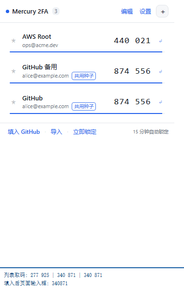

# Mercury 2FA

离线的 2FA 验证码扩展，支持 Chrome 与 Edge。不联网、不注册账号、不上云。

当前版本 **v0.7.0**：扫码导入、共用种子提醒、DEK 只在 offscreen 进程内存里。安装时不申请任何站点权限。

| 列表 | 扫码导入 |
|---|---|
|  |  |

## 已实现

| 模块 | 内容 |
|---|---|
| 取码内核 | TOTP / HOTP / Steam，走 WebCrypto，无自研密码学 |
| 加密 | Argon2id（hash-wasm）派生 KEK → 包住随机 DEK → AES-GCM-256 加密条目 |
| 进程边界 | 解密与取码只在 offscreen 文档里发生，popup 拿到的返回值里没有种子字段 |
| 解锁 | 主密码解锁，空闲 5/15/30/60 分钟自动锁定，系统空闲或锁屏立刻丢弃 DEK 并关闭 offscreen |
| 迁移 | 首次创建时自动把 v0.1 的明文库加密并入，原键删除 |
| 条目 | 添加 / 删除 / 置顶 / STEAM 与 HOTP 变体 / 倒计时进度条 / 剩余 5 秒转红 |
| 扫码 | 截当前页 → 本地 zxing-wasm 识别二维码 → 回填导入框，支持普通链接与 GA 迁移码 |
| 导入 | Google Authenticator 迁移码、Aegis、2FAS、andOTP、Bitwarden、otpauth 链接串 |
| 备份 | 加密备份导出与恢复、更换主密码（只重封装 DEK，库体不重写）、恢复时核对条数 |
| 自动填充 | 点图标后用 `activeTab` 临时注入，识别验证码框并写入；支持六格拆分与 shadow DOM |
| 剪贴板 | 复制后按设置（30 秒 / 1 分钟 / 2 分钟 / 不清空）由 offscreen 覆写 |
| 提醒 | 图标角标：超过 30 天没导出备份时出现 `!`；同一组种子挂在多个账号上时列表标「共用种子」 |
| 自检 | 内置四项检查：往返解密、错误密码拒绝、密文篡改检测、派生耗时 |

## 三个上下文，各管一件事

MV3 的 service worker 会被随时回收，popup 一关就消失，两者都不适合放密钥。唯一的常驻内存态上下文是 offscreen 文档，它没有界面、不进用户视野，正好用来装密钥。

```
popup（界面）  --命令-->  service worker（路由）  --命令-->  offscreen（解密、取码）
                        ↑ 只管创建/关闭文档、闹钟、角标          持有 DEK，只在内存变量里
```

- **popup 里没有解密代码路径。** 打包产物中 popup 分块对 `argon2id`、`wrappedDek`、`AES-GCM` 的匹配数都是 0，这些只出现在 offscreen 分块。这是可以对产物 `grep` 验证的事实，不是设计承诺。
- **命令走白名单。** 每条消息按 `op` 重建对象后才转发，多余字段丢弃；关掉 offscreen 文档就等于把 DEK 扔掉，下次打开必然要求重新输密码。
- **返回值过闸门。** 出站前扫一遍字段名，出现 `secret` 或 `secrets` 直接丢包。添加条目只回 `{ id }`，因为条目记录本身带种子。

## 二维码导入

点「扫描当前页二维码」，扩展截当前标签页，在本地用 zxing-wasm 解码，认出 `otpauth://` 或 `otpauth-migration://` 就回填到导入框，走同一套解析与预览。

三件事值得说明：

- **wasm 从扩展包里加载。** zxing-wasm 默认的 `locateFile` 会去 jsdelivr 拉 `.wasm`，那是远程代码，MV3 禁止，也与零网络冲突。这里改成 `new URL(<打包后的 asset>, location.href)`，wasm 作为 `assets/zxing_reader-*.wasm`（946 KB）随扩展分发。产物里仍能找到 jsdelivr 那行字符串，它在 zxing 自己的兜底分支里，我们的 `prepareZXingModule` 每次都传了 `locateFile`，那条分支不会执行 —— 这一点可以对照 `lib/qr-scan.ts` 与产物里的 `locateFile:Be` 自行核对。
- **按需加载。** 解码器是动态 `import()`，主包体不变，点按钮时才拉那 38 KB 的胶水代码与 wasm。
- **截图不出本机。** `captureVisibleTab` 的 data URL 在内存里转成字节直接喂给解码器，没有任何上传路径。

## 自动填充的边界

用 `activeTab` + `scripting.executeScript`，只有用户点开扩展图标的那一刻，浏览器才把当前标签页的注入权临时交出来。manifest 里没有 `host_permissions`，也没有常驻 `content_scripts`。

代价是两次点击：点图标、点「填入」。换来的是安装时权限面板只有「读取当前标签页」，商店审核不看站点清单。

识别打分（累加，≥ 60 分才写入）：

| 信号 | 分值 |
|---|---|
| `autocomplete="one-time-code"` | 100 |
| `autocomplete` 含 otp / code | 60~90 |
| `inputmode` 为 numeric/tel 且 `maxlength` 在 4~8 | 60 |
| name / id / placeholder / aria-label 含 otp、code、token、验证码 | 50 |
| 同表单内有密码字段 | +20 |
| `pattern` 是数字类 | +20 |
| `maxlength` 等于期望位数 | +20 |
| `type=password` / 隐藏 / 不可见 | 直接排除 |

四层兼容，缺一层就会在某些站点失效：

- **React / Vue 受控输入**：`HTMLInputElement.prototype` 的原生 setter 赋值，再派发 `input` 与 `change`
- **shadow DOM**：递归遍历 `shadowRoot`，`document.querySelector` 看不见的部分也能找到
- **六格拆分框**：同容器内 4~8 个 `maxlength=1` 且没有混入其他字段时，逐格写入并补 `keydown`/`keyup`
- **祖先链隐藏**：一路检查父级 `display:none` / `visibility:hidden`，只查自身会填到看不见的框

填充函数是自包含的：它被序列化后送进页面，拿不到种子、DEK 或保险库，只收到一个已经算好的验证码。

## 剪贴板的处理

复制动作留在 popup —— 那里有焦点、有用户手势，写入最可靠。清空交给 offscreen，因为 popup 关掉之后就不存在了，而闹钟到点时需要一个还活着的上下文去覆写。

设一个 `chrome.alarms`，到点后由 offscreen 调 `navigator.clipboard.writeText('')`，失败则退到 `document.execCommand('copy')`。

两个已知限制写在这里，不藏：

- `alarms` 的最小粒度是 30 秒，低于 30 秒的设置按 30 秒执行，所以没有更短的选项
- 扩展不申请 `clipboardRead`（那会让商店提示「读取你复制的内容」），因此无法判断剪贴板里是不是自己写的那串。这期间用户复制了别的东西，也会被一起清掉

**图标倒计时没有做。** 30 秒周期配 30 秒粒度的闹钟，角标只会永远显示同一个数字。这个想法在 MV3 下没有实现价值，换成备份健康度：超过 30 天没导出，角标变成琥珀色 `!`。

## 共用种子提醒

同一个种子挂在两个账号上，任意一处泄露等于两个账号同时失守，而多数人是在「给备用账号再扫一次码」时无意造成的。取码时按归一化后的种子分组，同组超过一条，两条都标「共用种子」。种子本身不进返回值，界面只知道一个布尔值。

## 验证结果

| 项目 | 结果 |
|---|---|
| 单元测试 | **139 项**全通过 |
| RFC 4226 十组 HOTP 向量 | 全部匹配 |
| RFC 6238 六时点 × SHA1/256/512 | 18 组全部匹配 |
| 命令白名单 | 未知 op / target 不符 / 缺字段 / 超长文本 / 多余字段注入，逐项拒绝 |
| 出站闸门 | 构造带 `secret` 的返回值被拦下；正常条目视图与导出文本放行 |
| 进程边界 | 建库后 `storage.session` 里没有任何 dek 键；换一个宿主即回到锁定态；锁定后取码报 `locked` |
| 命令层端到端 | 建库 → 添加 → 取码 → 导出 → 另一实例恢复 → 改密码后旧密码失效，全链路走真实服务 |
| 二维码 | 生成的样本图解码出原串，再交给导入解析得到 1 条 GitHub；无码图片返回空数组 |
| 共用种子 | 同种子两条互标、写法差异仍能认出、不同种子不标、返回值不含种子 |
| 浏览器端到端 | 加载真实构建产物：建库、加三条、取码，点「填入 GitHub」后 shadow DOM 输入框得到同一串码 |
| 浏览器扫码 | 真实产物 + 打包的 wasm：点「扫描当前页二维码」，识别出 otpauth 串、回填输入框、预览「GitHub alice@example.com TOTP·6位」 |
| 重载即锁 | 同一个配置目录重开页面，宿主重建，界面回到「保险库已锁定」 |
| 分块隔离 | popup 分块中 `argon2id` / `wrappedDek` / `AES-GCM` 匹配数均为 0 |
| 类型检查 | `tsc --noEmit` 0 错误 |
| 产物 | 1.30 MB（含 946 KB wasm），权限 `storage`、`idle`、`clipboardWrite`、`activeTab`、`scripting`、`alarms`、`offscreen`，无 `host_permissions` |

没验过的两条，必须在真机确认：

- `clipboardWrite` 的实际清空效果 —— 预览页没有扩展权限，测出来只能是拒绝
- 真实站点上的填充命中率 —— 页面结构与动态渲染时机复现不出来

## 未实现（明确列出）

| 项 | 卡在哪 |
|---|---|
| 常驻挂标（零点击） | 需要可选站点权限 + 商店逐条写理由，等 activeTab 路径跑够数据再说 |
| 全量 i18n | 界面目前只有中文，`_locales` 只覆盖名称与描述 |
| 时钟偏差提示 | 扩展看不到登录页的失败原因，只能靠用户自己发现，做不出可靠判定 |

## 安全模型

防住：

- 磁盘上的库：`chrome.storage.local` 里只有密文，攻击者拿到浏览器配置目录也解不开
- 界面进程拿种子：popup 与 service worker 里没有解密路径，DEK 只在 offscreen 的内存变量中
- 浏览器退出后的密钥：没有持久化，offscreen 一关就消失，锁定与超时都会关
- 挂着不用的会话：空闲超时、系统空闲、锁屏三处都会丢弃 DEK
- 密码猜错与密文被改：AES-GCM 认证失败直接拒绝，不做任何降级；解包失败报密码错，解包成功但解不开报内容损坏，两者提示分开
- 主密码更换：只重封装 DEK，旧密码立即失效
- 网页读种子：填充只传一个算好的验证码，页面侧拿不到种子
- 消息层面的越界：命令白名单 + 字段重建 + 出站扫 `secret`
- 扫码内容：截图在本地解码，不经过网络

不防：

- 解锁期间本机进程读扩展内存
- 键盘记录器与剪贴板嗅探
- 主密码忘记（没有后门，也没有找回流程，只有备份文件）
- 恢复码丢失

## 架构

```
entrypoints/popup        React 界面：锁屏、列表、添加、导入、设置
entrypoints/offscreen    唯一持有 DEK 的上下文，执行全部加解密与取码
entrypoints/background   service worker：创建/关闭 offscreen、转发命令、闹钟、角标
lib/protocol.ts          命令白名单、字段重建、出站 secret 闸门
lib/offscreen-router.ts  命令分发（纯函数，可脱离浏览器测试）
lib/remote-client.ts     popup 侧客户端，签名与 VaultService 一致
lib/qr-scan.ts           截图 + zxing-wasm 解码，wasm 走本地资产
lib/clipboard.ts         清空调度与文案
lib/fill/autofill.ts     注入到页面的自包含填充函数
lib/fill/inject.ts       activeTab 注入通道与结果翻译
lib/fill/site-match.ts   站点与发行方匹配（注册域、分词、编辑距离）
lib/vault-service.ts     业务逻辑（可注入时钟与存储，全部单测覆盖）
lib/crypto.ts            Argon2id + AES-GCM + 备份格式
lib/crypto-host.ts       加密边界；唯一实现把 DEK 放在内存变量里
lib/browser-store.ts     storage.local / storage.session 适配
lib/importers.ts         GA protobuf、各家 JSON、otpauth 串
lib/totp.ts …            取码内核
tests/                   139 项，含二维码样本与 jsdom 填充用例
```

## 数据格式

```ts
{
  schemaVersion: 2,
  kdf: { name: 'argon2id', m: 65536, t: 3, p: 1, salt: '<16B base64>' },
  wrappedDek: { iv: '<12B>', data: '<AES-GCM 密文>' },
  payload:    { iv: '<12B>', data: '<条目 JSON 的密文>' },
  entryCount: 3,
  createdAt, updatedAt
}
```

备份文件是 `{ format: 'mercury-2fa-backup', version: 2, exportedAt, entryCount, vault }`，`entryCount` 明文存放，恢复时与实际解出的条数比对。格式只服务本项目，不与其它项目共用。

三档派生强度：低 19MiB/t=2（约 100ms）、中 64MiB/t=3（约 400ms）、高 256MiB/t=4（约 1.5s）。参数写在密文头里，换档只重封装密钥。

## 命令

```bash
npm install
npm test              # 139 项
npm run compile       # tsc --noEmit
npm run build         # .output/chrome-mv3
npm run build:edge    # .output/edge-mv3
npm run zip           # 上架用压缩包
```

## 加载与绑定 GitHub

1. `chrome://extensions` → 开发者模式 → 加载已解压 → `.output\chrome-mv3`
2. 首次打开设主密码（建议中档），记录到密码管理器
3. GitHub → Settings → Password and authentication → Enable 2FA → Authenticator app
4. GitHub 的二维码页面点扩展图标 → 导入 → 「扫描当前页二维码」，识别后点「导入 1 条」。也可以手点二维码下方的 **enter this text code**，把 32 位 setup key 粘进 ＋ 的手填表单
5. 在 GitHub 的验证页点扩展图标，底部出现「填入 GitHub」，点一下自动写入
6. **立即到设置里导出加密备份**，并把 GitHub 的 recovery codes 存好

## 下一步

1. 真机回归：GitHub、Google、AWS、Cloudflare 四个登录页填通，十个只有密码框的页面零误填
2. 真机确认剪贴板 30 秒后确实被清空，以及锁定、重启、休眠三种情况下密钥不残留
3. 双商店提交（材料见 `docs/STORE.md`，隐私政策见 `docs/PRIVACY.md`）
4. 可选开启常驻内容脚本，换取页面加载即挂标的零点击体验
