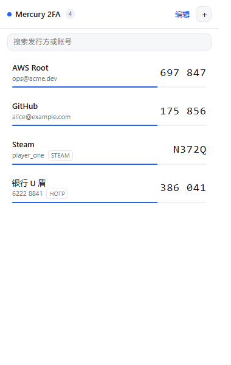

# Mercury 2FA

离线的 2FA 验证码扩展，支持 Chrome 与 Edge。不联网、不注册账号、不上云。

当前进度：**v0.1 内核完成**，可本地加载试用。



## 已完成

| 模块 | 内容 |
|---|---|
| 取码内核 | TOTP / HOTP / Steam，全部走 WebCrypto，无第三方加密库 |
| 链接解析 | `otpauth://` 宽容解析，容忍大小写、缺省参数、issuer 只写在 label 里 |
| 界面 | 条目列表、倒计时进度条、剩余 5 秒转红、一键复制、搜索、删除 |
| 添加 | 粘贴 otpauth 链接自动填充表单，或手填种子 |
| 打包 | 一份代码产出 `chrome-mv3` 与 `edge-mv3` 两套产物 |

## 验证结果

| 项目 | 结果 |
|---|---|
| 单元测试 | 35 项全通过（`npm test`） |
| RFC 4226 官方十组 HOTP 向量 | 全部匹配 |
| RFC 6238 六组时点 × SHA1/SHA256/SHA512 | 18 组全部匹配 |
| 类型检查 | `tsc --noEmit` 0 错误 |
| 产物体积 | 238 KB |
| manifest 权限 | `storage`、`clipboardWrite`，无 `host_permissions` |
| 扩展 ID | `phaaiimkjbieajjhclcdmbofgnmfhech`（由 `keys/pubkey.ts` 固定） |

RFC 6238 首组向量：种子 `12345678901234567890`，T = 59 秒，SHA-1 八位数输出 `94287082`，与实现一致。

## 目录

```
entrypoints/
  background.ts        service worker，v0.2 起承接消息路由与 offscreen 生命周期
  popup/
    index.html
    main.tsx           挂载
    App.tsx            列表、倒计时、复制、开发版提示
    AddForm.tsx        添加与 otpauth 解析
    style.css
lib/
  base32.ts            宽容解码与编码
  hotp.ts              HMAC、动态截断、HOTP、Steam
  totp.ts              时间步与失效时刻
  otpauth.ts           otpauth:// 解析
  store.ts             storage.local 读写、去重、导出
  types.ts
tests/
  totp.test.ts         RFC 4226 / 6238 向量 + 时间窗口
  otpauth.test.ts      解析容错与非法输入
keys/
  pubkey.ts            扩展公钥（固定 ID）
  chrome-key.pem       私钥，不入库，仅本机打包用
```

## 命令

```bash
npm install
npm test              # 跑 RFC 向量
npm run compile       # tsc --noEmit
npm run build         # 产出 .output/chrome-mv3
npm run build:edge    # 产出 .output/edge-mv3
```

## 本地加载

Chrome：打开 `chrome://extensions`，右上角开启「开发者模式」，点「加载已解压的扩展程序」，选 `D:\2FA_THEME26\.output\chrome-mv3`。

Edge：打开 `edge://extensions`，左侧开启「开发人员模式」，点「加载解压缩的扩展」，选 `.output\edge-mv3`。

首次打开会看到一条明文存储提示，确认后进入列表。点右上角 ＋ 可以粘一条 `otpauth://` 链接试跑。

## v0.1 的边界

- 种子以明文写入 `chrome.storage.local`，只适合本机自测
- 没有主密码、没有自动锁定
- 没有导入导出界面（`exportVault()` 已实现，未接线）
- 没有内容脚本，验证码靠点击复制
- 没有图标，浏览器显示默认占位图

## 下一步 v0.2

1. Argon2id（wasm）+ AES-GCM-256，密文头带 kdf 参数与版本
2. 解锁界面与自动锁定（5 / 15 / 30 分钟，`chrome.idle` 兜底）
3. offscreen document 作为加密仓，popup 只拿验证码，拿不到种子
4. 加密备份导出与导入
5. 验收：关浏览器重开后必须重新输密码；磁盘上抓不到任何 base32 种子
