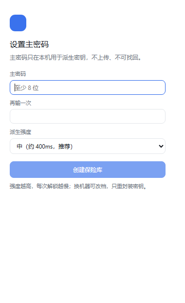
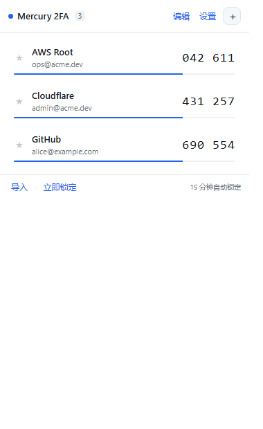

# Mercury 2FA

离线的 2FA 验证码扩展，支持 Chrome 与 Edge。不联网、不注册账号、不上云。

当前版本 **v0.4.0**：加密保险库、加密备份、批量导入、自动锁定全部可用，可以绑定真实账号。

| 首次设置 | 列表 |
|---|---|
|  |  |

## 已实现

| 模块 | 内容 |
|---|---|
| 取码内核 | TOTP / HOTP / Steam，走 WebCrypto，无自研密码学 |
| 加密 | Argon2id（hash-wasm）派生 KEK → 包住随机 DEK → AES-GCM-256 加密条目 |
| 解锁 | 主密码解锁，空闲 5/15/30/60 分钟自动锁定，系统空闲或锁屏立刻丢弃 DEK |
| 迁移 | 首次创建时自动把 v0.1 的明文库加密并入，原键删除 |
| 条目 | 添加 / 删除 / 置顶 / STEAM 与 HOTP 变体 / 倒计时进度条 / 剩余 5 秒转红 |
| 导入 | Google Authenticator 迁移码、Aegis、2FAS、andOTP、Bitwarden、otpauth 链接串 |
| 备份 | 加密备份导出与恢复、更换主密码（只重封装 DEK，库体不重写） |
| 自检 | 内置四项检查：往返解密、错误密码拒绝、密文篡改检测、派生耗时 |

## 验证结果

| 项目 | 结果 |
|---|---|
| 单元测试 | 73 项全通过 |
| RFC 4226 十组 HOTP 向量 | 全部匹配 |
| RFC 6238 六时点 × SHA1/256/512 | 18 组全部匹配 |
| 加密属性测试 | 错误密码拒绝、单字节篡改拒绝、IV 不重复、密文里搜不到明文 |
| 迁移码解析 | 手工构造 protobuf 字节流，TOTP + HOTP 双条目解析正确 |
| 浏览器实测 | 在无头 Chrome 里跑完整流程：设密码 → Argon2id 派生 → 建库 → 添加 → 取码 |
| CSP 实测 | 在 `script-src 'self' 'wasm-unsafe-eval'` 下派生正常，无 wasm 拦截 |
| 类型检查 | `tsc --noEmit` 0 错误 |
| 产物 | 324 KB，权限 `storage`、`idle`、`clipboardWrite`，无 `host_permissions` |

## 未实现（明确列出）

| 项 | 卡在哪 |
|---|---|
| 自动填充 | 需要 `host_permissions` 或可选权限 + 真实登录页回归测试，盲写风险高于收益 |
| 截图二维码导入 | 需要 `activeTab` + `captureVisibleTab` + zxing-wasm，另加约 1.5MB |
| 剪贴板定时回清 | service worker 没有 DOM，需要 offscreen document |
| 图标、i18n、双商店上架 | 收尾工程，功能稳定后再做 |

## 安全模型

防住：

- 磁盘上的库：`chrome.storage.local` 里只有密文，攻击者拿到浏览器配置目录也解不开
- 浏览器退出后的密钥：DEK 存在 `chrome.storage.session`（内存态），关浏览器即失
- 挂着不用的会话：空闲超时、系统空闲、锁屏三处都会丢弃 DEK
- 密码猜错与密文被改：AES-GCM 认证失败直接拒绝，不做任何降级
- 主密码更换：只重封装 DEK，旧密码立即失效

不防：

- 解锁期间本机进程读扩展内存
- 键盘记录器与剪贴板嗅探
- 主密码忘记（没有后门，也没有找回流程，只有备份文件）
- 恢复码丢失

## 架构

```
entrypoints/popup      React 界面：锁屏、列表、添加、导入、设置
entrypoints/background service worker：系统空闲/锁屏时丢弃 DEK
lib/vault-service.ts   业务逻辑（可注入时钟与存储，全部单测覆盖）
lib/crypto.ts          Argon2id + AES-GCM + 备份格式
lib/crypto-host.ts     加密边界；换 offscreen 实现时上层不动
lib/browser-store.ts   storage.local / storage.session 适配
lib/importers.ts       GA protobuf、各家 JSON、otpauth 串
lib/totp.ts …          取码内核
tests/                 73 项
```

**一处与最初设计的偏离**：DEK 现在放在 `chrome.storage.session`，没进 offscreen document。两者都是内存态、关浏览器即失、其他扩展与网页都读不到；session 存储省掉消息中转与生命周期管理，先把可用性做出来。等剪贴板回清或自动填充需要 offscreen 时，再把 `CryptoHost` 的实现换掉。

## 数据格式

```ts
{
  schemaVersion: 2,
  kdf: { name: 'argon2id', m: 65536, t: 3, p: 1, salt: '<16B base64>' },
  wrappedDek: { iv: '<12B>', data: '<AES-GCM 密文>' },
  payload:    { iv: '<12B>', data: '<条目 JSON 的密文>' },
  createdAt, updatedAt
}
```

三档派生强度：低 19MiB/t=2（约 100ms）、中 64MiB/t=3（约 400ms）、高 256MiB/t=4（约 1.5s）。参数写在密文头里，换档只重封装密钥。

## 命令

```bash
npm install
npm test              # 73 项，含 RFC 向量
npm run compile       # tsc --noEmit
npm run build         # .output/chrome-mv3
npm run build:edge    # .output/edge-mv3
```

## 加载与绑定 GitHub

1. `chrome://extensions` → 开发者模式 → 加载已解压 → `.output\chrome-mv3`
2. 首次打开设主密码（建议中档），记录到密码管理器
3. GitHub → Settings → Password and authentication → Enable 2FA → Authenticator app → **enter this text code**
4. 扩展点 ＋，发行方 `GitHub`，账号填用户名，种子粘那串 32 位 setup key（空格会自动清掉）
5. 复制 6 位码填回 GitHub，通过即绑定成功
6. **立即到设置里导出加密备份**，并把 GitHub 的 recovery codes 存好

## 下一步

1. 自动填充（可选权限 + 内容脚本 + 识别打分），需要先在 10 个真实登录页上做回归
2. 截图二维码导入（`captureVisibleTab` + zxing-wasm）
3. offscreen 加密仓与剪贴板回清
4. 双商店上架与 `_locales`
