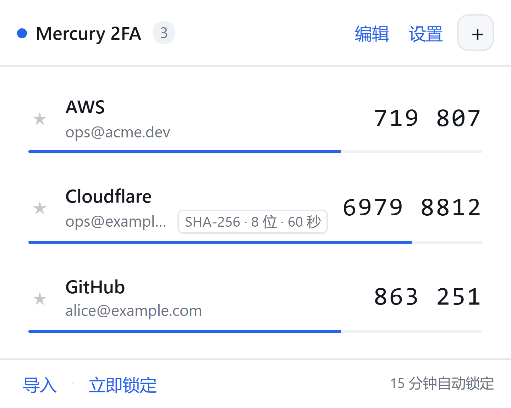
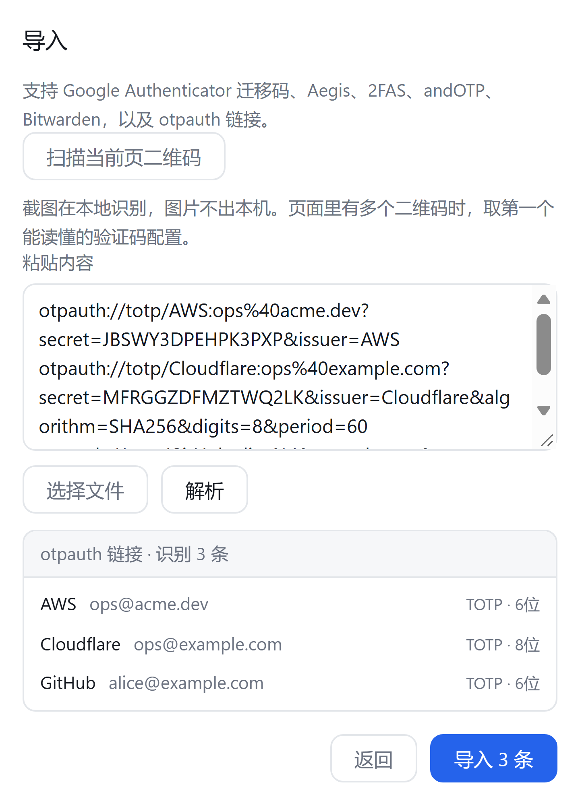

# Mercury 2FA

[English](README.md) | **简体中文**

Chrome 与 Edge 的两步验证（TOTP）扩展。验证码在本机计算，扩展不发起网络请求，不需要账号，不向云端写入任何内容。

[仓库](https://github.com/THEME26/mercury-2fa) · [隐私政策](https://theme26.github.io/mercury-2fa/privacy.html) · [实现说明](docs/DESIGN.zh-CN.md) · [验证结果](docs/VERIFICATION.zh-CN.md) · [上架材料](docs/STORE.zh-CN.md)

| 列表 | 导入 |
|---|---|
|  |  |

版本 0.8.2。八种界面语言、扫码导入、加密备份。安装时不申请站点权限；剪贴板清空默认关闭，需在设置里授权后启用。

## 安装

商店尚未上架，先构建并加载未打包版本：

```bash
npm install
npm run build:edge     # Edge；Chrome 用 npm run build
```

1. 地址栏输入 `edge://extensions`，左侧开启「开发人员模式」
2. 点「加载解压缩的扩展」，选中 `D:\2FA_THEME26\.output\edge-mv3`（选中目录本身）
3. 扩展列表内打开「Mercury 2FA」→「详细信息」→ 开启「在工具栏中显示」

Chrome 的步骤相同，地址为 `chrome://extensions`，目录换成 `.output/chrome-mv3`。

未打包安装直接引用构建目录：移动或删除 `.output/edge-mv3` 后扩展立即失效。重新构建后在扩展卡片上点「重新加载」。`Alt+Shift+M` 打开面板；扩展 ID 为 `phaaiimkjbieajjhclcdmbofgnmfhech`，两个浏览器一致。

## 使用

1. 首次打开时设置主密码。没有找回流程，密码记进密码管理器。派生强度可调，默认中档。
2. 点面板顶部的 ＋ 按钮手动添加，或进「导入」粘贴导出文件、`otpauth` 链接。
3. 点图标读取验证码，点一下复制。
4. 在登录页点图标，按「填入 <站点>」，验证码写入扩展识别出的输入框。
5. 在设置里导出加密备份。没导出过时图标上带琥珀色 `!`，每次导出后静默 30 天。

设置页包含自动锁定（空闲 5 / 15 / 30 / 60 分钟）、剪贴板清空（默认关闭，启用后可选 30 秒 / 1 分钟 / 2 分钟 / 不清空）、更换主密码、备份导出与恢复、四项自检、界面语言。

### 首个账号（GitHub）

1. GitHub → Settings → Password and authentication → Enable 2FA → Authenticator app
2. 在二维码页面点扩展图标 → 导入 → 「扫描当前页二维码」，识别后点「导入 1 条」。扫描不成功时点 **enter this text code**，把 32 位 setup key 粘进 ＋ 表单。
3. 在验证页点图标，按「填入 GitHub」。
4. 导出加密备份，并把 GitHub 的 recovery codes 存好。

## 功能

| 模块 | 内容 |
|---|---|
| 保险库 | 条目用 AES-GCM-256 加密，密钥由主密码经 Argon2id 派生。 |
| 解锁 | 主密码解锁；空闲超时、系统空闲、锁屏均自动锁定。 |
| 验证码 | TOTP、HOTP、Steam；SHA-1/256/512；6~8 位；自定义周期。非默认参数在行内标出。 |
| 条目 | 添加、删除、置顶；倒计时条在最后 5 秒转红。 |
| 添加与导入 | 手动录入、Google Authenticator 迁移码、Aegis、2FAS、andOTP、Bitwarden 导出、otpauth 链接串。 |
| 扫码 | 截取当前标签页，在本地解码。 |
| 自动填充 | 点击后注入当前标签页；支持六格拆分框、shadow DOM、React/Vue 受控输入。 |
| 剪贴板 | 安装后即可复制；复制后的定时清空默认关闭，需授予一项可选权限。 |
| 备份 | 加密导出与恢复，恢复时核对条数，更换主密码只重封装密钥。 |
| 提醒 | 共用种子标记；备份时效角标。 |
| 语言 | 八种界面语言，默认英文。 |

## 安全模型

已防护：

- **静态的库。** `chrome.storage.local` 里只有密文，拿到浏览器配置目录也解不开。
- **界面进程。** popup 与 service worker 内没有解密路径，密钥在无界面的 offscreen 文档里。
- **会话残留。** 锁定、空闲超时、系统空闲、锁屏都会丢弃密钥并关闭文档，不做持久化。
- **密码猜错与密文篡改。** AES-GCM 认证失败直接拒绝，不做降级。解包失败报密码错，解包成功而内容解不开报损坏，两者提示分开。
- **更换主密码。** 只重封装密钥，旧密码立即失效。
- **网页。** 填充只接收一个已算好的验证码，页面侧拿不到种子。
- **消息越界。** 命令白名单、字段重建、出站扫描丢弃名为 `secret` 的字段。

未防护：

- 解锁期间本机进程读取扩展内存。
- 键盘记录器与剪贴板嗅探。
- 主密码遗忘。没有后门，没有找回流程，只有备份文件。

每条边界的理由与字段识别打分表见 [docs/DESIGN.zh-CN.md](docs/DESIGN.zh-CN.md)。

## 多语言

默认英文。另有简体中文、繁体中文、日文、韩文、德文、法文、西班牙文随扩展分发，在「设置 → 语言」内切换。

偏好存在 `storage.local`，位于保险库之外，锁定界面在解密任何内容之前即可按所选语言渲染。manifest 的名称与描述走另一条路径：`_locales` 使其跟随浏览器语言。

八份字典缺键会在类型检查阶段失败，`tests/i18n.test.ts` 另外断言键集合相同与占位符一致。

## 构建

```bash
npm install
npm test               # 173 项
npm run compile        # tsc --noEmit
npm run build          # .output/chrome-mv3
npm run build:edge     # .output/edge-mv3
npm run zip            # 两个目标各出一份商店包
npm run pack           # 构建 Edge 并打包
npm run assets         # 图标与 1280×800 商店截图
npm run shots          # 在真实 Edge 构建里重截源图
npm run shots -- zh-CN # 同上，中文一套
```

压缩包 562 KB，解压后 1.43 MB，共 25 个文件，其中 946 KB 是二维码解码用的 wasm。

## 文档

| 文档 | 内容 |
|---|---|
| [docs/DESIGN.zh-CN.md](docs/DESIGN.zh-CN.md) | 上下文划分、二维码解码、填充打分、剪贴板、数据格式、源码结构 |
| [docs/VERIFICATION.zh-CN.md](docs/VERIFICATION.zh-CN.md) | 每条断言对应的检查，以及两项尚未验证的内容 |
| [docs/STORE.zh-CN.md](docs/STORE.zh-CN.md) | 商店文案、权限理由、素材清单、提交流程 |
| [docs/PRIVACY.zh-CN.md](docs/PRIVACY.zh-CN.md) | 存了什么、存在哪、什么不出本机 |
| [NOTICE](NOTICE) | 第三方组件与各自许可证 |

## 未实现

| 项 | 原因 |
|---|---|
| 常驻挂标 | 需要可选站点权限与商店逐条理由 |
| 时钟偏差提示 | 扩展看不到登录失败的原因，任何判定都是猜测 |
| 其余六种语言的商店截图 | 文案与界面须一致，每加一种都要单独截一轮 |

## 致谢

代码由 [WorkBuddy](https://www.workbuddy.ai) 作为编码代理编写，底层模型为 DeepSeek-V4.1-Flash。本仓库的代码、测试、商店截图与文档均在这些会话中产出；[docs/VERIFICATION.zh-CN.md](docs/VERIFICATION.zh-CN.md) 中的每条断言都对真实产物核过。

## 许可证

MIT，见 [LICENSE](LICENSE)。第三方组件列于 [NOTICE](NOTICE)。
